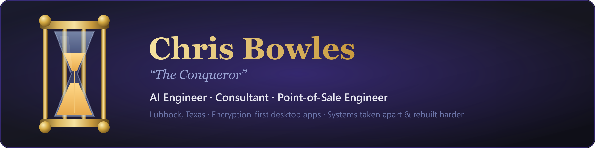
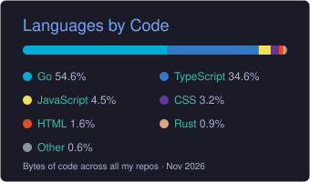

**AI Engineer · Consultant · Point-of-Sale Engineer**
I build AI-driven systems and point-of-sale platforms, ship secure desktop software, and advise teams on getting it right — with an artist's eye for how it all comes together.

🚀 **Currently:** **LANcast 1.0 is out** — a self-hosted media server for films, TV, music, photos, comics, audiobooks and retro games. Next up: a native Roku app.

---

## 👋 About

I take systems apart to understand them, then rebuild them harder and cleaner. Fifteen years as an IT engineer and technical-support specialist taught me how real systems fail; the rest of my path — game design, competitive gaming, creative teaching, and now AI — taught me how to make them hold.

- 🤖 **AI Engineer** — I design and build AI-driven tooling and automation, wiring models into real workflows that ship.
- 🧭 **Consultant** — I advise teams on architecture, security, and quality, then help them execute — not just diagnose.
- 🛒 **Point-of-Sale Engineer** — I build and integrate point-of-sale systems, from the transaction flow to the hardware it runs on.
- 🔒 **Security-minded builder** — encryption-at-rest, hardened desktop apps, and adversarial QA tooling are my default, not an afterthought.
- 🎨 **Artist & art teacher** — a former full-time artist and art instructor; I still lead small classes now and then, and that eye for design carries into everything I build.

---

## 🔥 What I'm building

### 📺 [LANcast](https://github.com/Conqueror-Mod/LANcast) — *v1.0, stable*
**Your own media server.** Films, TV, music, photos, comics, audiobooks and retro games — on your hardware, under your control, with nothing phoning home. Plex's streamlined polish, Kodi's customizability, and neither one's compromises: no subscription, no account with anybody, no relay you rent.

  

- 🎬 **Films and TV that look after themselves** — collections build themselves, intros and credits are found by listening to and looking at the episodes, and any field you correct is locked against every refresh and rescan
- ▶️ **Plays almost anything** — libmpv in the desktop app; everywhere else the server chooses direct play, remux or transcode and *tells you why*, with hardware encoding picked by a real test encode
- 🍿 **Watch Together across the internet** — synchronised rooms, paired servers that see what friends are watching, and *Play on another device* from your phone to the TV-room PC
- 🎵 **Music done properly** — gapless playback, crossfades, synced lyrics, ReplayGain, MusicBrainz albums, and full **MilkDrop** visualizers with their shaders
- 🕹️ **Retro games** — identified by hash, played in the app or a browser, saves kept server-side, with **RetroAchievements** pop-ups in-game
- 👥 **Built for a household** — per-person accounts, private-by-default viewing, content-rating limits, passkeys and two-factor sign-in
- 🔒 **Secure by default** — loopback-only until the first account exists, then HTTPS with a pinned key, server-side sessions, double CSRF defence, and a sandboxed **WebAssembly plugin runtime** (deny-by-default)
- 🐹 **Under the hood** — Go · pure-Go SQLite (no cgo) · React + TypeScript · one documented HTTP API with an OpenAPI spec · Windows app + service, Linux systemd · self-updating, signed releases · 125 decision records

### ⏱️ [Conquered Time](https://github.com/Conqueror-Mod/conquered-time)
**Professional time-intelligence for remote pros juggling multiple clients.** A secure desktop time tracker where everything lives in an **AES-256-encrypted local vault** — no cloud, no account server, no outbound calls.

- 🔒 **Security-first** — AES-256-GCM at rest, PBKDF2 (310k) key derivation, TOTP MFA + Windows Hello, one-time recovery, hardened sandboxed Electron with a strict CSP
- 🌌 **Company Galaxy** — your client network as an interactive packed-bubble map, with identity colors that follow each company across the whole app
- 🧾 **Invoicing & audit** — turn tracked hours into numbered PDF invoices; an audit engine flags punch discrepancies; scheduled email reports over your own SMTP
- ⚡ **Lives in the tray** — global clock-in/out hotkey, idle nudges, and a self-updater that ships new versions straight from GitHub Releases
- 🛠️ **Under the hood** — Electron · TypeScript (strict) · sql.js (WASM SQLite, zero native deps) · property-tested crypto paths

### 🧪 The Crucible *(private)* — *RCA › DMAIC › PDCA*
The adversarial QA tooling I use to keep apps like Conquered Time honest — a method and a runnable tool. Point it at any website, Electron app, or **native desktop app**; it crawls every reachable state, runs adversarial probes, and emits a **ranked defect register**. The name reads inside-out: **RCA** on every individual defect, sitting inside a **DMAIC** campaign, whose Improve phase is made of **PDCA** fix loops.

- 🦀 Rust core · 🌲 native accessibility walkers (Windows UIA · macOS AX · Linux AT-SPI) · 🎭 Playwright adapter for web/Electron over CDP

### 🔐 Project-Gambit *(private)*
**A research design toward a successor to MFA / passkeys.** Passkeys fixed phishing but froze the credential: one keypair, valid until revoked, and a theft you never see. Gambit mutates the credential on *every* successful handshake — so a cloned one desyncs the moment either copy is used, making cloning self-expiring and detectable — and pairs it with a glyph handshake ceremony that turns server authentication into something a human can actually *see*.

- 🎯 Aims at the **fallback downgrade** ("passkeys unavailable, enter your backup code"), the dominant real-world passkey bypass
- 🔬 Conceptual, with both load-bearing protocols machine-checked in **Tamarin** — not cryptographically reviewed, and not a library to deploy

---

## 🧰 Toolbox

---

## 📊 Stats

| | 📺 [LANcast](https://github.com/Conqueror-Mod/LANcast) | ⏱️ [Conquered Time](https://github.com/Conqueror-Mod/conquered-time) |
|---|---|---|
| **Latest release** | v1.0.1 | v3.27.1 |
| **Started** | Jul 2026 | Jun 2026 |
| **Commits** | ~3,000 | ~480 |
| **Merged PRs** | 1,170 | 172 |
| **Tests** | 4,400+ Go · 2,400+ client | 160+, property tests on the crypto paths |
| **Code** | ~280k lines of Go | ~12k lines of TypeScript |
| **Design records** | 125 ADRs | 6 feature plans + a vault-format spec |

Project figures as of November 2026.

---

*"Melt it down under adversarial load, and prove what survives."*

**Reach me**

